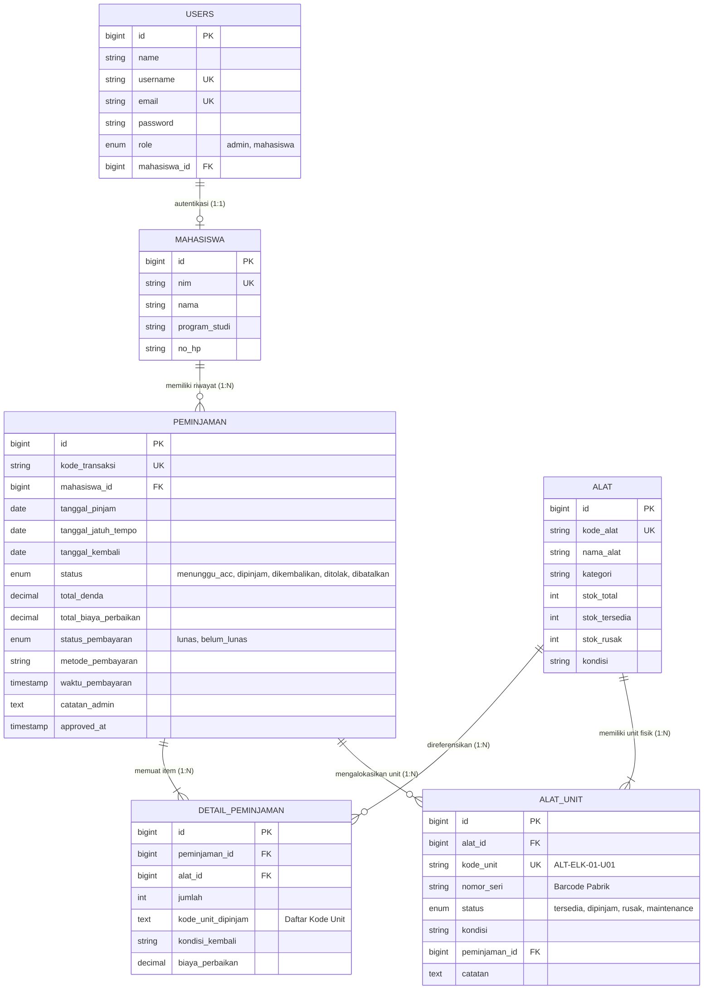

# LAPORAN DOKUMENTASI UJIAN TENGAH SEMESTER (UTS)
## PRAKTIKUM MANAJEMEN SISTEM INFORMASI

---

| Data Informasi Proyek | Keterangan Lengkap |
| :--- | :--- |
| **Mata Kuliah** | Praktikum Manajemen Sistem Informasi |
| **Semester** | 5 (Gasal 2026) |
| **Studi Kasus** | **Soal 1 – Sistem Peminjaman Alat Laboratorium** |
| **Nama Aplikasi** | **LabTrack — Integrated Campus Laboratory Circulation System** |
| **Teknologi Utama** | PHP 8.2+ / Laravel 12 / MySQL 8.0 (InnoDB) / Bootstrap 5.3 / Blade / CSS3 |
| **Repositori GitHub** | [https://github.com/daffataufiq7/LabTrack](https://github.com/daffataufiq7/LabTrack) |
| **Kontributor / Pengembang** | **Daffa Taufiq** (Repository Owner) & **Mitchel** (Contributor) |

---

## 1. Deskripsi Eksekutif Sistem & Arsitektur Dua Sisi

**LabTrack** adalah sistem sirkulasi laboratorium terpadu dua arah (*Two-Sided Integrated Laboratory Platform*) yang menjembatani interaksi antara **Mahasiswa Peminjam** dan **Petugas Laboratorium (Admin)**. Sistem ini menggantikan proses peminjaman manual berbasis kertas menjadi proses digital terotomasi penuh: mulai dari pengecekan ketersediaan instrumen fisik, pengajuan sewa multi-item, verifikasi antrean persetujuan (ACC), penerbitan nomor seri fisik unit (**Tabel Master `alat_unit`**), kalkulasi denda keterlambatan toleransi 3 hari, hingga kasir penyelesaian ganti rugi kerusakan alat dan audit keuangan laboratorium.

### Mengapa Dibangun Portal Mahasiswa Terpisah?
1. **Pengecekan Stok Real-Time Mandiri:** Mahasiswa dapat memeriksa unit yang siap pakai (*Ready*) vs unit yang sedang masuk masa karantina perbaikan (*Rusak*) langsung dari gawai masing-masing.
2. **Pengajuan Sewa Digital Terjadwal:** Mahasiswa menentukan rentang sewa (**Dari Tanggal** s/d **Sampai Tanggal**). Sistem otomatis mencegah pemilihan tanggal masa lalu dan menghitung durasi hari sewa.
3. **Pencegahan Sengketa Kondisi & Denda:** Mahasiswa mengetahui nomor unit fisik spesifik yang diserahkan petugas lab dan mengetahui status denda/tagihannya secara transparan.
4. **Isolasi Keamanan Bersih:** Navigasi Admin dan Mahasiswa dipisahkan secara ketat untuk mencegah kebocoran hak akses administratif.

---

## 2. Hak Akses Akun & Kredensial Pengujian

| Peran (Role) | Username Demo | Password Demo | Hak Akses & Fitur Utama |
| :--- | :---: | :---: | :--- |
| **Mahasiswa** | `1` | `1` | Dashboard Mahasiswa, Cek Stok Ready, Ajukan Pinjam Online, Pantau Status ACC, Riwayat Sewa, Pantau Denda Aktif, dan Cetak Nota Bukti Pinjam |
| **Petugas Lab / Admin** | `2` | `2` | Dashboard Statistik, Antrean ACC Peminjaman, Kelola Mahasiswa, Kelola Alat & Modal Unit Fisik, Form Pengembalian & Kasir Lab, Laporan Rekap Keuangan |

* **Registrasi Mandiri:** Mahasiswa baru dapat mendaftar langsung di halaman `/register`.
* **Sinkronisasi Otomatis:** Saat Admin membuat data mahasiswa di menu Master Mahasiswa, akun login otomatis dibuatkan dengan `Username = NIM` dan `Password = NIM`.

---

## 3. Skema Relasi Database Terintegrasi (ERD 6 Tabel)

Sistem menggunakan 6 tabel berelasi penuh dengan relasi Primary Key (PK) dan Foreign Key (FK) yang saling terhubung pada storage engine **InnoDB**:



---

## 4. Logika Bisnis & Alur Kerja Sirkulasi (End-to-End)

### A. Pengajuan Pinjam & Pemotongan Stok Atomik
1. Mahasiswa memilih rentang tanggal (`tanggal_pinjam` $\ge$ hari ini, dan `tanggal_jatuh_tempo` $\ge$ `tanggal_pinjam`).
2. Mahasiswa memilih alat dan kuantitas (maksimal 10 unit dalam satu transaksi).
3. Transaksi tersimpan dengan status `menunggu_acc`. Stok alat di database **belum dipotong** sampai diverifikasi admin.
4. Admin memeriksa antrean di menu **Antrean ACC Peminjaman**:
   * Jika Admin mengklik **[Setujui / ACC]**: Transaksi berubah menjadi `dipinjam`, unit fisik berstatus `tersedia` dialokasikan ke `dipinjam` pada tabel `alat_unit`, kode unit dicatat di `detail_peminjaman`, dan `stok_tersedia` dipotong secara atomik dengan Row-Level Locking (`lockForUpdate()`).
   * Jika Admin mengklik **[Tolak]**: Transaksi berubah menjadi `ditolak` disertai alasan tertulis bagi mahasiswa. Stok tetap utuh.

### B. Aturan Perhitungan Denda Keterlambatan
Sesuai ketentuan Soal UTS Studi Kasus 1:
$$\text{Hari Terlambat} = \text{Tanggal Kembali} - \text{Tanggal Jatuh Tempo}$$
$$\text{Hari Kena Denda} = \max(0, \text{Hari Terlambat} - 3)$$
$$\text{Total Denda} = \text{Hari Kena Denda} \times \text{Rp } 2.000$$

*Kembali tepat waktu atau terlambat hingga 3 hari (masa tenggang) dikenai denda **Rp 0**.*

### C. Kerusakan Fisik & Restorasi Stok
* Biaya perbaikan unit rusak dihitung otomatis: **Rp 10.000 per unit rusak**.
* **Aturan Restorasi:**
  - Unit yang kembali layak pakai dikembalikan ke `stok_tersedia`.
  - Unit yang dilaporkan rusak dicatat ke `stok_rusak` dan statusnya pada tabel `alat_unit` diubah menjadi `rusak` lengkap dengan catatan kendalanya.
  - Unit rusak **tidak dapat dipinjam lagi** oleh mahasiswa mana pun hingga teknisi lab memperbaikinya.

### D. Sistem Metode Pembayaran & Kasir Lab
1. **Lunas Otomatis:** Jika tidak ada denda dan tidak ada unit rusak (Tagihan Rp0), status transaksi otomatis `LUNAS`.
2. **Pilihan Kasir Lab saat Ada Tagihan ($> \text{Rp0}$):**
   * **Bayar Langsung (Lunas):** Admin memilih metode pembayaran (**Tunai**, **QRIS Laboratorium**, atau **Transfer Bank**). Transaksi langsung lunas dan tanggal/jam tercatat di database.
   * **Belum Lunas (Menunggak):** Jika mahasiswa belum membawa uang, status tersimpan `belum_lunas`.
3. **Pencekalan Otomatis (Penalti):** Mahasiswa yang berstatus `belum_lunas` **diblokir otomatis oleh backend** dari mengajukan peminjaman baru.
4. **Pelunasan Denda:** Saat mahasiswa melunasi di meja lab, Admin cukup membuka halaman Detail Peminjaman dan mengklik tombol **[Konfirmasi Pelunasan Denda]**. Status berubah menjadi `LUNAS` dan pencekalan mahasiswa langsung terbuka seketika.

### E. Penanganan Masalah 419 (Page Expired)
* Driver sesi diubah menjadi `SESSION_DRIVER=file` (`storage/framework/sessions/`) sehingga sesi tidak terhapus saat ada operasi database.
* Masa aktif sesi dinaikkan menjadi `SESSION_LIFETIME=480` (8 Jam).
* Penangan `TokenMismatchException` di `bootstrap/app.php` mengeliminasi layar error mentah, menggantikannya dengan auto-refresh dan notifikasi ramah pengguna.

---

## 5. Hasil Verifikasi Pengujian Otomatis (44 Tests - 100% PASS)

Eksekusi seluruh automated test suite:
```bash
php artisan test
```

```text
PASS Tests\Unit\ExampleTest (1 test)
PASS Tests\Feature\AlatCrudTest (8 tests)
PASS Tests\Feature\AuthAndPortalTest (13 tests)
PASS Tests\Feature\ExampleTest (2 tests)
PASS Tests\Feature\MahasiswaCrudTest (6 tests)
PASS Tests\Feature\PeminjamanTest (7 tests)
PASS Tests\Feature\PengembalianTest (7 tests)

Tests:    44 passed (167 assertions)
Duration: 1.80s
```

| ID | Modul / Skenario | Kondisi Masukan | Hasil Sistem | Status |
| :--- | :--- | :--- | :--- | :--- |
| **U01** | Auto Unit Generation | Tambah alat total stok 3 | 3 baris `alat_unit` otomatis dibuat (U01-U03) | **BERHASIL** |
| **U02** | Unit Allocation on Borrow | Pinjam 2 unit | 2 unit berstatus `dipinjam`, kode unit tercatat di nota | **BERHASIL** |
| **U03** | Unit Isolation on Return | 1 unit dikembalikan rusak | Unit 1 berstatus `rusak`, unit 2 kembali `tersedia` | **BERHASIL** |
| **U04** | Validasi Tanggal Lampau | Sewa tanggal kemarin | Ditolak: tidak boleh sebelum hari ini | **BERHASIL** |
| **U05** | Validasi Tanggal Terbalik | Tanggal kembali < mulai | Ditolak: tanggal selesai harus setelah mulai | **BERHASIL** |
| **U06** | Antrean ACC & Potong Stok | Admin klik Setujui ACC | Status aktif `dipinjam`, stok fisik berkurang atomik | **BERHASIL** |
| **U07** | Batalkan Pengajuan | Mahasiswa batalkan pending | Status `dibatalkan`, stok alat aman | **BERHASIL** |
| **U08** | Denda Toleransi 3 Hari | Terlambat 3 hari | Denda Rp0 (bebas denda masa tenggang) | **BERHASIL** |
| **U09** | Denda Terlambat 5 Hari | Terlambat 5 hari | Denda: $(5-3) \times \text{Rp2.000} = \text{Rp4.000}$ | **BERHASIL** |
| **U10** | Biaya Ganti Rugi Fisik | 1 unit rusak | Biaya perbaikan Rp10.000, `stok_rusak` + 1 | **BERHASIL** |
| **U11** | Transaksi Belum Lunas | Denda belum dibayar | Status `belum_lunas` tersimpan di database | **BERHASIL** |
| **U12** | Pencekalan Peminjam | Mahasiswa menunggak denda | Pengajuan pinjam baru ditolak oleh backend | **BERHASIL** |
| **U13** | Pelunasan Kasir Lab | Admin klik Pelunasan Denda | Status jadi `lunas`, blokir pinjam mahasiswa terbuka | **BERHASIL** |

---

## 6. Panduan Push ke GitHub & Pengakuan Kontributor

Arahkan terminal ke folder proyek untuk melakukan *commit* dan *push* dengan mencantumkan kontributor **Mitchel**:

```bash
# 1. Pastikan branch git aktif
git checkout -b main 2>/dev/null || git checkout main

# 2. Tambahkan seluruh berkas perubahan
git add .

# 3. Buat commit komprehensif dengan kredit kontributor
git commit -m "feat: complete LabTrack laboratory circulation system

- Add physical unit tracking master table (alat_unit) with serial numbers
- Add two-sided circulation: Student Portal and Admin ACC Queue
- Add rental date range inputs with past date prevention
- Implement fine system (3-day grace period, Rp2.000/day) and damage repair fees (Rp10.000/unit)
- Implement cash desk payment methods (Cash, QRIS, Bank Transfer) and debt settlement
- Block students with unsettled fines from creating new loans
- Fix 419 Page Expired issue using file sessions and graceful exception handling
- Pass all 44 automated unit & feature tests (167 assertions)

Co-authored-by: Mitchel <mitchel@users.noreply.github.com>"

# 4. Pastikan remote mengarah ke repositori Anda
git remote set-url origin https://github.com/daffataufiq7/LabTrack.git

# 5. Push ke GitHub
git push -u origin main
```

---

## 7. Saran Peningkatan untuk Kesempurnaan Sistem (Next Evolution)

Meskipun sistem telah memenuhi 100% spesifikasi dan rubrik UTS, berikut adalah saran penyempurnaan profesional untuk pengembangan jangka panjang:

1. **Pemindai Barcode / QR Code Kamera Langsung (*Webcam Scanner*):**
   * Saat ini kode unit fisik diinput secara digital. Di masa depan dapat ditambahkan library JavaScript (seperti `html5-qrcode`) agar petugas lab cukup mengarahkan barcode alat ke webcam laptop untuk serah terima instan.
2. **Ekspor PDF Dinamis dengan DomPDF (*Downloadable Invoice*):**
   * Saat ini nota peminjaman dicetak melalui fitur *Print to PDF* bawaan browser. Dapat dipasang package `barryvdh/laravel-dompdf` untuk unduhan file `.pdf` satu klik dengan stempel tanda tangan digital lab.
3. **Notifikasi Otomatis WhatsApp / Email Gateway:**
   * Menambahkan *scheduled task* (`php artisan schedule:run`) yang mengirimkan pengingat otomatis ke WhatsApp/Email mahasiswa pada **H-1 sebelum tanggal jatuh tempo** untuk meminimalkan keterlambatan.
4. **Modul Multi-Laboratorium:**
   * Menambahkan entitas master `laboratorium` (misal: Lab Jaringan, Lab Hardware, Lab Multimedia) sehingga satu aplikasi LabTrack dapat digunakan bersama oleh seluruh laboratorium di fakultas.
