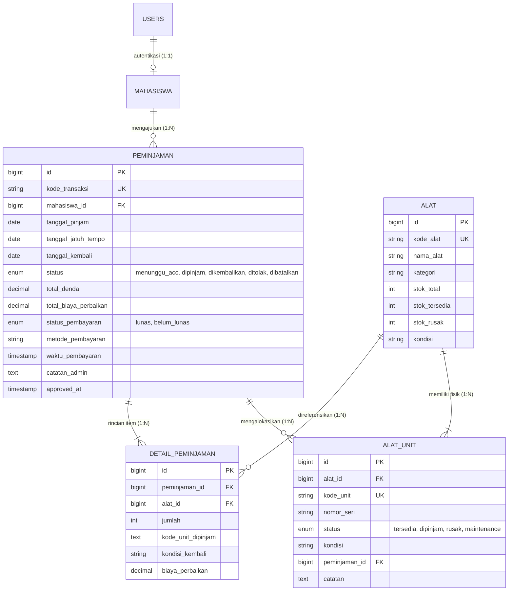

# LabTrack — Sistem Peminjaman Alat Laboratorium

[](https://laravel.com)
[](https://php.net)
[](https://getbootstrap.com)
[](https://mariadb.org)
[-brightgreen.svg)]()
[](https://github.com/daffataufiq7/LabTrack)

**LabTrack** adalah aplikasi sistem informasi manajemen laboratorium kampus berbasis web (Laravel 12 & MySQL) yang dirancang untuk mengelola inventaris instrumen praktikum, sirkulasi peminjaman dua arah (**Portal Mahasiswa Mandiri** & **Panel Admin Petugas Lab**), verifikasi antrean persetujuan (ACC), pelacakan nomor seri fisik unit (**Tabel Master `alat_unit`**), modul inspeksi pengembalian, serta otomasi perhitungan denda keterlambatan dan kasir penyelesaian ganti rugi kerusakan alat secara terpadu, aman, dan transparan.

Aplikasi ini dibangun untuk memenuhi spesifikasi lengkap tugas **Ujian Tengah Semester (UTS) Praktikum Manajemen Sistem Informasi**.

---

## 👥 Tim Pengembang & Kontributor

* **Owner & Lead Developer:** [Daffa Taufiq](https://github.com/daffataufiq7)
* **Contributor & Collaborator:** [Mitchel](https://github.com/daffataufiq7/LabTrack)

---

## 🔑 Kredensial Login Cepat (Demo Realistis)

Akses URL: `http://127.0.0.1:8000/login`

| Peran | Username | Password | Halaman Masuk | Fitur Utama |
| :--- | :---: | :---: | :--- | :--- |
| **Mahasiswa** | `1` | `1` | `/portal/dashboard` | Cek stok ready, ajukan pinjam online, pantau ACC, pantau denda, riwayat transaksi & nota digital |
| **Admin / Petugas Lab** | `2` | `2` | `/dashboard` | Antrean ACC peminjaman, master mahasiswa, master alat & tracking unit fisik, form pengembalian kasir lab, rekap laporan keuangan |

> **Registrasi Mandiri:** Mahasiswa baru dapat mendaftar langsung melalui tombol **Daftar Akun Mahasiswa Baru** (`/register`). Sistem secara atomik membuat data di tabel `mahasiswa` dan akun di tabel `users`.

---

## 📋 Fitur Utama & Keunggulan Sistem

### 1. Portal Mahasiswa Mandiri (*Self-Service Student Circulation*)
* **Katalog Stok Ready Transparan:** Menampilkan stok alat yang benar-benar siap dipinjam, membedakan unit yang layak pakai vs unit yang sedang masuk masa karantina perbaikan.
* **Pengajuan Pinjam Dinamis (Multi-Item):** Mahasiswa dapat memilih tanggal rentang sewa (**Dari Tanggal** s/d **Sampai Tanggal**). Sistem otomatis mencegah pemilihan tanggal sebelum hari ini dan menampilkan kalkulator durasi sewa (*X Hari*).
* **Halaman Riwayat Mahasiswa (`/portal/riwayat`):** Dilengkapi sistem tab interaktif (*Semua, Menunggu ACC, Aktif Dipinjam, Selesai, Ditolak*) dengan fitur batalkan permohonan mandiri jika mahasiswa salah input.
* **Bukti Nota Digital:** Mahasiswa dapat melihat dan mencetak nota peminjaman ber-barcode yang memuat kode unit fisik resmi yang diterbitkan oleh petugas lab.

### 2. Panel Petugas Laboratorium (Admin)
* **Antrean Persetujuan (ACC):** Verifikasi permohonan pinjam dari mahasiswa. Pemotongan stok alat dilakukan secara atomik di database hanya saat Admin mengklik tombol **[Setujui / ACC]**.
* **Manajemen Unit Fisik (`alat_unit`):** Setiap unit fisik instrumen laboratorium memiliki Kode Unit dan Serial Number unik (misal: `ALT-ELK-001-U01`, `ALT-ELK-001-U02`). Admin dapat memantau status setiap unit (*Tersedia, Dipinjam, Rusak, Maintenance*) melalui tombol pop-up modal **[Unit]** pada menu Data Alat.
* **Kasir Pengembalian & Restorasi Stok:**
  - Menghitung otomatis denda keterlambatan dengan **masa tenggang 3 hari** dan tarif **Rp 2.000 / hari**.
  - Menginspeksi kondisi fisik alat. Biaya kerusakan dihitung otomatis **Rp 10.000 / unit rusak**.
  - **Aturan Restorasi Stok Fisik:** Unit yang kembali dalam kondisi baik dikembalikan ke `stok_tersedia`. Unit yang rusak otomatis diisolasi ke `stok_rusak` dan ditandai rusak pada tabel `alat_unit` sehingga tidak akan pernah bisa dipinjam oleh mahasiswa lain.
* **Sistem Metode Pembayaran (Kasir Lab):**
  - Jika tagihan denda/kerusakan Rp0 $\rightarrow$ Otomatis berstatus `LUNAS`.
  - Jika ada tagihan $> \text{Rp0}$ $\rightarrow$ Admin dapat mencatat **Lunas Langsung** (*Tunai, QRIS Laboratorium, Transfer Bank*) atau **Belum Lunas (Menunggak)** jika mahasiswa belum membawa uang.
  - **Sistem Penalti:** Mahasiswa yang memiliki status pembayaran `belum_lunas` otomatis diblokir dari mengajukan peminjaman baru sampai dendanya dilunasi.
  - **Pelunasan Denda:** Admin dapat mengonfirmasi pelunasan kapan saja di halaman Detail Peminjaman dengan tombol **[Konfirmasi Pelunasan Denda]**, yang langsung membuka blokir mahasiswa.
* **Laporan & Rekapitulasi Keuangan:** Menampilkan rekapitulasi total denda, total biaya kerusakan, serta ekspor cetak laporan ramah printer (*Clean Print Layout*).

---

## 💻 Prasyarat Sistem

* **PHP** versi 8.2 atau lebih baru (ekstensi: `pdo_mysql`, `mbstring`, `openssl`, `curl`, `fileinfo`)
* **Composer** versi 2.x
* **MySQL** atau **MariaDB** (melalui XAMPP/Laragon/Native)
* **Web Browser Modern** (Chrome, Edge, Firefox)

---

## ⚙️ Panduan Instalasi Cepat

```bash
# 1. Clone repositori
git clone https://github.com/daffataufiq7/LabTrack.git
cd LabTrack

# 2. Instal dependensi PHP
composer install

# 3. Konfigurasi Environment
cp .env.example .env
php artisan key:generate

# 4. Sesuaikan konfigurasi database di file .env:
# DB_CONNECTION=mysql
# DB_HOST=127.0.0.1
# DB_PORT=3306
# DB_DATABASE=labtrack
# DB_USERNAME=root
# DB_PASSWORD=

# 5. Migrasi Skema Tabel & Data Awal Demo Realistis
php artisan migrate:fresh --seed

# 6. Jalankan server lokal
php artisan serve
```

Akses aplikasi di: **`http://127.0.0.1:8000`**

---

## 🗄️ Struktur & Skema Database

Sistem dibangun menggunakan 6 tabel relasional MySQL berstandar normalisasi tinggi (InnoDB):



---

## 🧪 Pengujian Otomatis (Testing)

Seluruh logika bisnis, transaksi database, pencegahan balapan data (*race condition*), pemotongan stok atomik, dan validasi formulir dilindungi oleh automated test suite:

```bash
php artisan test
```

### Hasil Pengujian: **44 Passed, 0 Failed (167 Assertions)**
* `AlatCrudTest`: CRUD alat, pencegahan hapus alat bertransaksi, auto-generate unit fisik, dan tracking unit rusak.
* `MahasiswaCrudTest`: CRUD mahasiswa, validasi NIM unik, dan pencegahan hapus mahasiswa bertransaksi.
* `PeminjamanTest`: Peminjaman multi-item, rollback stok atomik, validasi tanggal jatuh tempo, batasan kuota 10 unit, pencegahan pinjam saat ada keterlambatan.
* `PengembalianTest`: Pengembalian tepat waktu, denda toleransi 3 hari, biaya kerusakan Rp10.000/unit, pencegahan pengembalian ganda, sistem tagihan belum lunas & blokir pinjam baru, serta konfirmasi pelunasan kasir lab.
* `AuthAndPortalTest`: Login multi-peran, registrasi mandiri, katalog mahasiswa, pengajuan status `menunggu_acc`, ACC admin, tolak admin, riwayat mahasiswa, dan pembatalan mandiri.

---

## 🛡️ Keamanan & Kestabilan Sistem

1. **Pencegahan Error 419 (Page Expired):**
   * Menggunakan `SESSION_DRIVER=file` dan `SESSION_LIFETIME=480` menit agar sesi tidak mudah hilang.
   * Dilengkapi *Exception Handler* `TokenMismatchException` di `bootstrap/app.php` yang secara elegan me-refresh halaman dan menampilkan notifikasi tanpa memunculkan layar error mentah.
2. **Integritas Transaksi Atomik:**
   * Menggunakan `DB::transaction()` dan `lockForUpdate()` (Row-level Locking) pada setiap mutasi stok dan alokasi unit fisik guna mencegah *race condition* atau *overselling* alat.
3. **Pencegahan SQL Injection & XSS:**
   * Memanfaatkan PDO Parameter Binding bawaan Eloquent ORM serta HTML escaping otomatis di Blade engine (`{{ ... }}`).

---

## 📄 Lisensi & Hak Cipta
Dikembangkan untuk keperluan akademik **Ujian Tengah Semester Praktikum Manajemen Sistem Informasi**.  
Hak cipta © 2026 **LabTrack Team** ([Daffa Taufiq](https://github.com/daffataufiq7) & [Mitchel](https://github.com/daffataufiq7/LabTrack)).
